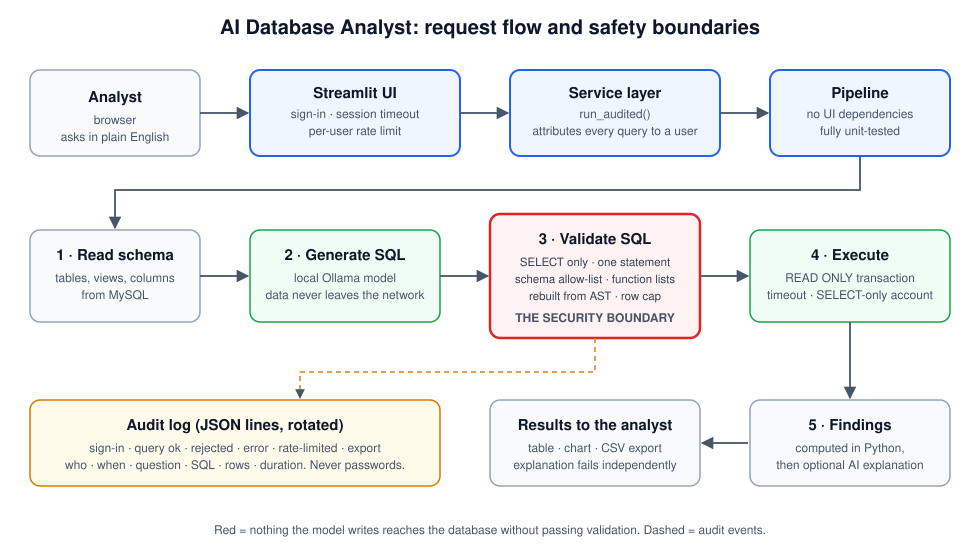
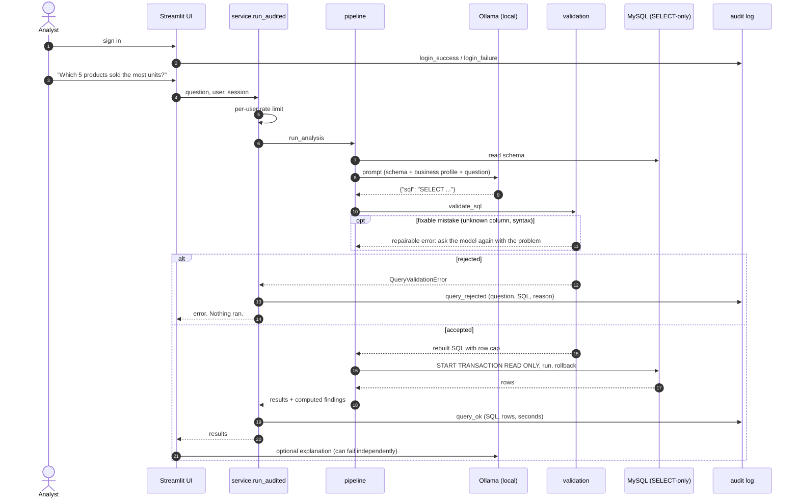

# Architecture

## Request flow

## Modules

| Module | Responsibility | Depends on Streamlit? |
| --- | --- | --- |
| `ui.py` | Rendering, login form, session handling | yes (only this module and `streamlit_app.py`) |
| `service.py` | Rate limit + audit around the pipeline; startup checks | no |
| `pipeline.py` | schema → SQL → validate → execute → findings | no |
| `validation.py` | The security boundary (SQLGlot parse, allow-lists, row cap) | no |
| `llm.py`, `sqlgen.py`, `prompts.py` | Ollama client with classified errors, SQL generation, prompts | no |
| `db.py`, `schema.py` | MySQL access (read-only transaction, timeout, row cap, optional TLS) and schema discovery with keys, comments and hidden-column filtering | no |
| `domain.py` | Business profile (YAML): metrics, glossary, examples, hidden data; reloaded on change | no |
| `analysis.py`, `explain.py` | Findings computed in Python; optional AI explanation | no |
| `auth.py` | scrypt password hashing, users file, login throttling, proxy identity | no |
| `audit.py` | Append-only JSON-lines audit trail | no |
| `ratelimit.py` | Sliding-window limiter | no |
| `credentials.py` | Resolves the DB password from secret file / env / sidebar | no |
| `config.py` | `ANALYST_*` settings, clamped to safe ranges | no |
| `cli.py` | `run`, `check`, `users` commands | no |

Everything except `ui.py` can be imported and tested without Streamlit installed. That is why
the business logic has unit tests while the UI stays thin.

## Design decisions

- **Defense in depth, not trust in the model.** The LLM is treated as an untrusted author. Its output is
  parsed, checked against the live schema, rebuilt from the syntax tree (so comments and odd formatting
  cannot smuggle anything through), checked again, and only then run, inside a read-only transaction,
  by a database account that has `SELECT` and nothing else. Any single layer failing does not
  expose the data.
- **Local model.** Questions and result rows go to Ollama on your own infrastructure, never to a third party.
- **Honest numbers.** Findings are computed in Python from the returned rows. The AI explanation is clearly
  labelled, bounded, and fails independently, so a slow model never hides results.
- **No secrets in `Settings`.** The database password is resolved on demand (`credentials.py`), so it cannot
  show up in a `repr()`, log line or crash report.
- **Fail visible, not silent.** Misconfiguration (no users, unwritable audit log, unreadable secret file)
  blocks the app with a clear message instead of running half-secured.
